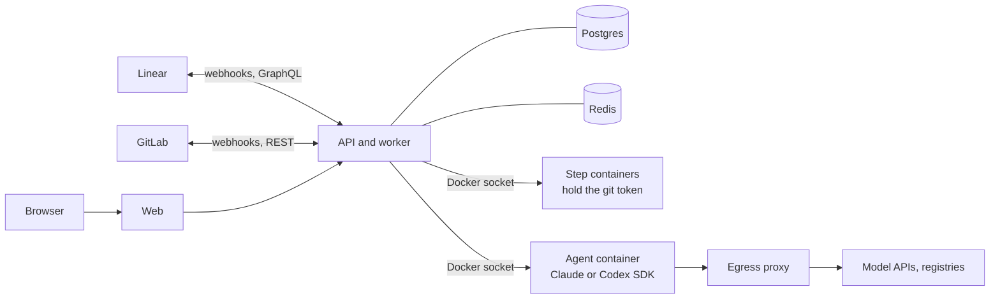

<p align="center"></p>

<h1 align="center">Factorix</h1>

<p align="center">The agentic software factory.</p>

Factorix gives AI agents accounts, skills, and connections, then lets them take a ticket from assignment to a reviewed merge request. Trackers and code hosts plug in through an open contract, and your tracker and your repositories stay the source of truth. Every agent action is attributed and audited, and a person decides how much each project can do alone.



## What it does

- **Open to any source.** Trackers and code hosts connect through an open contract for connectors, and Linear and GitLab ship with it. A project follows a team or project in the tracker. Open issues import in the background, along with recently closed ones, and text renders with that source's own formatting, references, and media.
- **Runs agents in sandboxes.** Claude and Codex run through their SDKs in throwaway Docker containers, with skills, archetypes, and per-project network rules.
- **Works across repositories.** A project sets which GitLab repositories agents may change. Each ticket changes only the ones it needs, with one merge request per repository, and the agent decides the merge order for that ticket. Merging checks every merge request first and stops at the first one that cannot land. A person then retries the rest, reverts what merged, or keeps it.
- **Gives agents their own accounts, or one shared account.** Each agent can use its own GitLab and Linear connection, or the project's. You choose per agent.
- **Cleans up after itself.** Package caches go when a run ends and a workspace goes when its issue finishes, so disk use follows open work.
- **Closes the loop.** An engineer agent implements, a reviewer agent reviews, and review comments go back to the engineer. Plans and merges can wait for a person.
- **Automates with workflows.** Build flows from blocks on a canvas: branch, wait for events, hand work to agents, create tickets, and post to Slack. Run them on tickets by hand or let ticket events start them.
- **Keeps a record.** Runs stream live with full tool calls, spend is tracked per agent and project, and the audit log is append-only at the database level.

## Quick start

One command installs what is missing and starts everything:

```sh
curl -fsSL https://raw.githubusercontent.com/WebEferen/factorix/main/install.sh | bash
```

From a checkout, run `./install.sh` instead. It installs Docker if needed, creates `.env` with a generated secret key, builds the images, and starts the stack. Running it again is safe and keeps your `.env`.

- On Linux it uses Docker's official script and asks for `sudo`.
- On macOS it uses Homebrew. Docker Desktop asks you to accept its terms the first time it opens. Without Homebrew, the script points you to the download.
- Outside a checkout it downloads Factorix to `~/factorix`, or to `FACTORIX_DIR` if you set it.

To do it by hand, with Docker already running:

```sh
cp .env.example .env
# Set FACTORIX_SECRET_KEY in .env: openssl rand -base64 32
docker compose --profile build-only build
docker compose up -d --wait
```

Open http://localhost:4101 and create the first admin account. To try the whole flow without a model key, turn on Allow the scripted runtime under Settings, General, and switch an agent's runtime to Scripted.

### Connect your accounts

1. Under Settings, Connections, add Linear with a personal API key.
2. Add GitLab with a token that has `api` and `write_repository`.
3. Add an Anthropic key, an OpenAI key, or both.
4. Under Projects, create a project. The wizard joins a Linear team or project to one or more GitLab repositories.

Linear and GitLab can only deliver webhooks to a public URL. Set `FACTORIX_PUBLIC_URL` to one, such as a tunnel, or rely on polling, which catches up every five minutes.

### Choose whose accounts agents use

By default every agent shares the project's Linear and GitLab accounts, told apart by comment prefixes, commit trailers, and the audit log. That is one account to pay for.

To give an agent its own, add another connection under Settings, Connections, then pick it under Accounts on the agent. Its commits, merge requests, reviews, and comments then use that account. It needs access to the project's repositories, and a GitLab account on another server is ignored with a warning in the run log. Merges, webhooks, polling, and status changes stay on the project's account.

GitLab may refuse a bot's approval of a merge request the same account opened, and the verdict still counts. A separate account for the reviewer avoids that.

### Give an agent work

- In Factorix, assign an agent on an issue.
- In Linear, add the agent's label from the `Agent` group while the issue is in a trigger state.

### Choose how much agents do alone

| Autonomy     | What happens                                                                                     |
| ------------ | ------------------------------------------------------------------------------------------------ |
| Plan first   | The agent writes a plan. A person signs it off before any code is written, and a person merges.  |
| Human merges | The agent implements and the reviewer reviews. A person merges.                                  |
| Full auto    | Once the reviewer approves and CI is green on every merge request, the factory merges by itself. |

## Configuration

The environment sets the defaults, and admins can override most of them under Settings, General without a restart. Use the default on that page clears an override.

These can be set in both places:

| Variable                            | Default                 | Purpose                                                                                                                     |
| ----------------------------------- | ----------------------- | --------------------------------------------------------------------------------------------------------------------------- |
| `FACTORIX_RUN_CONCURRENCY`          | `3`                     | Agents running at once, per worker.                                                                                         |
| `FACTORIX_ALLOW_SCRIPTED_RUNTIME`   | `false`                 | Allows a stand-in for the model. Keep it off in production.                                                                 |
| `FACTORIX_SYNC_INTERVAL_SECONDS`    | `300`                   | How often polling catches up with the tracker and the code host.                                                            |
| `FACTORIX_CLOSED_ISSUE_DAYS`        | `90`                    | How far back an import reaches for closed issues.                                                                           |
| `FACTORIX_NOTE_DEBOUNCE_MINUTES`    | `3`                     | Review comments in this window become one round of changes.                                                                 |
| `FACTORIX_CI_WAIT_MINUTES`          | `30`                    | The longest the reviewer waits for CI.                                                                                      |
| `FACTORIX_CLEAR_RUN_CACHE`          | `true`                  | Deletes package caches from a workspace when a run ends.                                                                    |
| `FACTORIX_FINISHED_WORKSPACE_HOURS` | `0`                     | How long a done or cancelled issue keeps its workspace. Cleanup runs every 15 minutes.                                      |
| `FACTORIX_FAILED_WORKSPACE_DAYS`    | `7`                     | How long a failed issue keeps its workspace, which can hold unpushed work.                                                  |
| `FACTORIX_OPEN_WORKSPACE_DAYS`      | `30`                    | How long an open issue with no runs keeps its workspace.                                                                    |
| `FACTORIX_FAILED_CONTAINER_HOURS`   | `1`                     | How long a failed agent's container stays for inspection.                                                                   |
| `FACTORIX_PUBLIC_URL`               | `http://localhost:4101` | The address browsers and webhooks use. Link previews keep the one `web` was built with, so rebuild `web` after changing it. |
| `COOKIE_SECURE`                     | `false`                 | HTTPS-only sign-in cookies. Needs an https public URL.                                                                      |
| `FACTORIX_SESSION_DAYS`             | `30`                    | How long a sign-in lasts.                                                                                                   |

These are set only in the environment:

| Variable                              | Default                     | Purpose                                                                                                 |
| ------------------------------------- | --------------------------- | ------------------------------------------------------------------------------------------------------- |
| `FACTORIX_SECRET_KEY`                 | required                    | Encrypts stored connection secrets. Losing it makes them unreadable.                                    |
| `FACTORIX_WEB_BIND`                   | `127.0.0.1`                 | The address port 4101 binds to.                                                                         |
| `ANTHROPIC_API_KEY`, `OPENAI_API_KEY` | none                        | Fallback model keys. A connection under Settings takes priority.                                        |
| `FACTORIX_SANDBOX_IMAGE`              | `factorix/sandbox-base:dev` | The image agents and git steps run in. It stays out of the web UI because the git steps hold the token. |

Compose sets `DATABASE_URL`, `REDIS_URL`, `PORT`, `HOST`, `FACTORIX_STEP_NETWORK`, `FACTORIX_AGENT_NETWORK`, and `FACTORIX_PROXY_URL`. You only need them when running the API outside Compose.

## Security model

Tracker text, repository contents, and agent output are all treated as untrusted.

- **The git token never enters a container that runs agent or repo code.** Token steps work only on a separate bare mirror. The boundary is data in `packages/sandbox/src/profiles.ts`, and a Docker test plants a real `core.fsmonitor` attack against it.
- **Model keys stay out of agent containers.** Each run gets a short-lived token, and the egress proxy swaps it for the real key.
- **Agents have one way out.** Their network is internal, and the proxy enforces a per-project allowlist: package registries, the hosts each connector declares, what the organization sets under Settings, Network (which can extend or replace those defaults), and whatever the project adds in its settings. Denied requests show up in the run log.
- **Containers are locked down.** They run as non-root with all capabilities dropped, with memory, CPU, process, and time limits. Review and plan phases mount the code read-only.
- **Untrusted text cannot phone home.** It renders as Markdown with raw HTML dropped, and a content security policy only loads images and video through the same-origin media proxy.
- **Secrets are encrypted at rest** with AES-256-GCM, and webhooks are verified and deduplicated.

More detail is in [docs/architecture.md](docs/architecture.md).

## Operating it

The [runbook](docs/runbook.md) covers deploying on a VM, upgrades, backups and restore, disk use, rotating secrets, and what to check when something looks stuck.

In short: put TLS in front of port 4101, turn on HTTPS-only cookies, keep `FACTORIX_SECRET_KEY` somewhere safe, and back up Postgres before upgrades. The worker mounts the Docker socket, so treat the host as part of the trusted base.

## Development

Use Node 22 (`.nvmrc`) and Yarn 1. Docker must be running for integration and Docker tests.

```sh
yarn install
yarn dev               # Postgres, Redis, API, worker, web
yarn lint
yarn typecheck
yarn test:unit
yarn test:integration  # real Postgres and Redis
yarn sandbox:build     # after changing packages/runner or docker/sandbox*
yarn test:docker       # real containers, real git, needs the sandbox image
yarn prepare-mr        # everything a merge request needs, short of Docker tests
```

| Path                  | What lives there                                              |
| --------------------- | ------------------------------------------------------------- |
| `apps/api`            | Fastify API and BullMQ worker                                 |
| `apps/web`            | Next.js App Router UI                                         |
| `apps/egress-proxy`   | The only network path out of an agent container               |
| `packages/core`       | Pure domain: state machines, pipeline engine, phases, prompts |
| `packages/runtime`    | The contract between worker and runner                        |
| `packages/runner`     | Runs in the sandbox and hosts the SDKs                        |
| `packages/sandbox`    | Docker provider and the credential boundary                   |
| `packages/connectors` | Linear and GitLab, with their markup, filters and sorts       |
| `packages/db`         | Knex client, raw SQL migrations, row types                    |
| `packages/schemas`    | Inputs and DTOs shared by API and web                         |

[AGENTS.md](AGENTS.md) has the rules that keep it safe and how to extend it with a new phase, connector, or model runtime.

## Known limits

- **One organization in practice.** Tables carry `org_id`, but only one organization can be set up today.
- **Email and password only.** There is no SSO yet.
- **Two connectors so far.** Linear and GitLab ship today. Other sources implement the same connector interfaces.

## License

MIT, see [LICENSE](LICENSE). The Averta font files in `apps/web/public/fonts` belong to their own author and are not covered by it.
