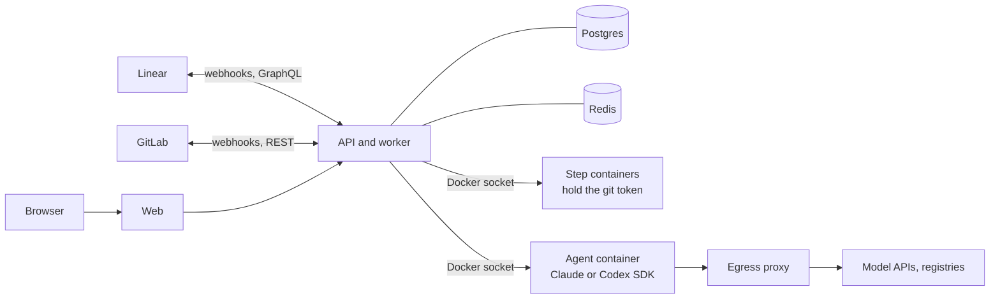

<p align="center"></p>

<h1 align="center">Factorix</h1>

<p align="center">The agentic software factory.</p>

Factorix gives AI agents accounts, skills, and connections, then lets them take a ticket from assignment to a reviewed merge request. Linear stays the tracker and GitLab stays the source. Every agent action is attributed and audited, and a person decides how much each project can do alone.



## What it does

- **Mirrors Linear.** Each project follows a Linear team or project. Open issues import in the background, along with issues closed in the last 90 days. Text renders with that source's own formatting, references, and media.
- **Runs agents in sandboxes.** Claude and Codex run through their SDKs in throwaway Docker containers, with skills, archetypes, and per-project network rules.
- **Works across repositories.** A project sets which GitLab repositories agents may change. Each ticket changes only the ones it needs, with one merge request per repository, and the agent decides the merge order for that ticket.
- **Closes the loop.** An engineer agent implements, a reviewer agent reviews, and review comments go back to the engineer. Plans and merges can wait for a person.
- **Automates with workflows.** Build flows from blocks on a canvas: branch, wait for events, hand work to agents, create tickets, and post to Slack. Run them on tickets by hand or let ticket events start them.
- **Keeps a record.** Runs stream live with full tool calls, spend is tracked per agent and project, and the audit log is append-only at the database level.

## Quick start

Docker is the only requirement.

```sh
cp .env.example .env
# Set FACTORIX_SECRET_KEY in .env: openssl rand -base64 32
docker compose --profile build-only build
docker compose up -d --wait
```

Open http://localhost:4101 and create the first admin account. To try the whole flow without a model key, set `FACTORIX_ALLOW_SCRIPTED_RUNTIME=true` and switch an agent's runtime to Scripted.

### Connect your accounts

1. Under Settings, Connections, add Linear with a personal API key.
2. Add GitLab with a token that has `api` and `write_repository`.
3. Add an Anthropic key, an OpenAI key, or both.
4. Under Projects, create a project. The wizard joins a Linear team or project to one or more GitLab repositories.

Linear and GitLab can only deliver webhooks to a public URL. Set `FACTORIX_PUBLIC_URL` to one, such as a tunnel, or rely on polling, which catches up every five minutes.

### Give an agent work

- In Factorix, assign an agent on an issue.
- In Linear, add the agent's label from the `Agent` group while the issue is in a trigger state.

### Choose how much agents do alone

| Autonomy     | What happens                                                                                     |
| ------------ | ------------------------------------------------------------------------------------------------ |
| Plan first   | The agent writes a plan. A person signs it off before any code is written, and a person merges.  |
| Human merges | The agent implements and the reviewer reviews. A person merges.                                  |
| Full auto    | Once the reviewer approves and CI is green on every merge request, the factory merges by itself. |

## Configuration

Set these in `.env`. Compose fills in the rest of the wiring.

| Variable                              | Default                     | Purpose                                                                                                                |
| ------------------------------------- | --------------------------- | ---------------------------------------------------------------------------------------------------------------------- |
| `FACTORIX_SECRET_KEY`                 | required                    | Encrypts stored connection secrets. Losing it makes them unreadable.                                                   |
| `FACTORIX_PUBLIC_URL`                 | `http://localhost:4101`     | The address browsers and webhooks use. Baked into the web image for link previews, so rebuild `web` after changing it. |
| `COOKIE_SECURE`                       | `false`                     | Set to `true` behind TLS.                                                                                              |
| `FACTORIX_WEB_BIND`                   | `127.0.0.1`                 | The address port 4101 binds to.                                                                                        |
| `FACTORIX_ALLOW_SCRIPTED_RUNTIME`     | `false`                     | Allows a stand-in for the model. Keep it off in production.                                                            |
| `ANTHROPIC_API_KEY`, `OPENAI_API_KEY` | none                        | Fallback model keys. A connection under Settings takes priority.                                                       |
| `FACTORIX_RUN_CONCURRENCY`            | `3`                         | Runs one worker executes at a time.                                                                                    |
| `FACTORIX_SYNC_INTERVAL_SECONDS`      | `300`                       | How often polling catches up with Linear and GitLab.                                                                   |
| `FACTORIX_SANDBOX_IMAGE`              | `factorix/sandbox-base:dev` | The image agents and git steps run in.                                                                                 |

Compose sets `DATABASE_URL`, `REDIS_URL`, `PORT`, `HOST`, `FACTORIX_STEP_NETWORK`, `FACTORIX_AGENT_NETWORK`, and `FACTORIX_PROXY_URL`. You only need them when running the API outside Compose.

## Security model

Tracker text, repository contents, and agent output are all treated as untrusted.

- **The git token never enters a container that runs agent or repo code.** Token steps work only on a separate bare mirror. The boundary is data in `packages/sandbox/src/profiles.ts`, and a Docker test plants a real `core.fsmonitor` attack against it.
- **Model keys stay out of agent containers.** Each run gets a short-lived token, and the egress proxy swaps it for the real key.
- **Agents have one way out.** Their network is internal, and the proxy enforces a per-project allowlist: package registries, the hosts each connector declares, what the organization sets under Settings, Network (which can extend or replace those defaults), and whatever the project adds in its settings. Denied requests show up in the run log.
- **Containers are locked down.** They run as non-root with all capabilities dropped, with memory, CPU, process, and time limits. Review and plan phases mount the code read-only.
- **Untrusted text cannot phone home.** It renders as Markdown with raw HTML dropped, and a content security policy only loads images and video through the same-origin media proxy.
- **Secrets are encrypted at rest** with AES-256-GCM, and webhooks are verified and deduplicated.

More detail is in [docs/architecture.md](docs/architecture.md).

## Operating it

The [runbook](docs/runbook.md) covers deploying on a VM, upgrades, backups and restore, disk use, rotating secrets, and what to check when something looks stuck.

In short: put TLS in front of port 4101, set `COOKIE_SECURE=true`, keep `FACTORIX_SECRET_KEY` somewhere safe, and back up Postgres before upgrades. The worker mounts the Docker socket, so treat the host as part of the trusted base.

## Development

Use Node 22 (`.nvmrc`) and Yarn 1. Docker must be running for integration and Docker tests.

```sh
yarn install
yarn dev               # Postgres, Redis, API, worker, web
yarn lint
yarn typecheck
yarn test:unit
yarn test:integration  # real Postgres and Redis
yarn sandbox:build     # after changing packages/runner or docker/sandbox*
yarn test:docker       # real containers, real git, needs the sandbox image
yarn prepare-mr        # everything a merge request needs, short of Docker tests
```

| Path                  | What lives there                                              |
| --------------------- | ------------------------------------------------------------- |
| `apps/api`            | Fastify API and BullMQ worker                                 |
| `apps/web`            | Next.js App Router UI                                         |
| `apps/egress-proxy`   | The only network path out of an agent container               |
| `packages/core`       | Pure domain: state machines, pipeline engine, phases, prompts |
| `packages/runtime`    | The contract between worker and runner                        |
| `packages/runner`     | Runs in the sandbox and hosts the SDKs                        |
| `packages/sandbox`    | Docker provider and the credential boundary                   |
| `packages/connectors` | Linear and GitLab, with their markup, filters and sorts       |
| `packages/db`         | Knex client, raw SQL migrations, row types                    |
| `packages/schemas`    | Inputs and DTOs shared by API and web                         |

[AGENTS.md](AGENTS.md) has the rules that keep it safe and how to extend it with a new phase, connector, or model runtime.

## Known limits

- **Early.** This is version 0.1.0. Full flows are tested on real containers and real git, using a scripted model and fake Linear and GitLab APIs. Importing from the real Linear API works. Merge request flows against real GitLab and live Claude or Codex runs have not been exercised yet.
- **One bot identity.** A GitLab connection can name the bot on its commits, but agents still share one Linear and one GitLab account, told apart by comment prefixes, commit trailers, and the audit log. GitLab may refuse a bot's approval of its own merge request, and the verdict still counts.
- **One organization in practice.** Tables carry `org_id`, but only one organization can be set up today.
- **Email and password only.** There is no SSO yet.
- **Linear and GitLab only.** Other sources go through the connector interfaces.
- **Merges across repositories are not atomic.** If a later merge is refused, earlier ones have already landed.
- **Disk grows with issues.** Each issue clones every repository in its project.

## License

MIT, see [LICENSE](LICENSE). The Averta font files in `apps/web/public/fonts` belong to their own author and are not covered by it.
